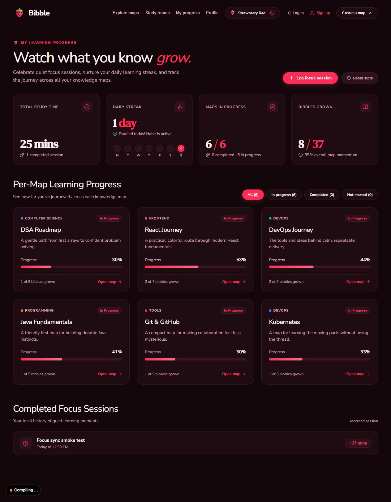

# Focus history synchronization

Apply `20261122020000_focus_history.sql` before deploying the client. Set both
server and `NEXT_PUBLIC_` Supabase variables to the same project/public key.
Signed-out visitors retain a local-only guest workspace (the existing server
Supabase configuration is still required by the proxy). The root
layout supplies verified identity; auth transitions refresh that layout and
remount its scoped workspace. A failed verification never selects another
account's cache.

Each immutable focus session has a stable ID and its own browser storage key.
Different tabs can finish sessions without replacing one shared array. Legacy
arrays upgrade once; malformed data and failed/quota-limited migrations preserve
the original. Account caches and the guest workspace use separate prefixes.

On sign-in, guest sessions are claimed by that account, copied to its pending
queue, and uploaded in batches of at most 100. Originals remain until that
account's RPC acknowledges them. Claims prevent a subsequent account on the same
browser from importing another account's pending guest records. Retry is triggered
by recording a session, reconnecting, every 30 seconds, and the visible retry
button. Network/auth errors do not report cloud success. Browser storage must be
available; quota errors are shown instead of reporting an unsaved session as saved.

The database identifies sessions by `(user_id, id)` and ignores repeat inserts,
so retries cannot double-count minutes. Ownership and the intended account ID
are checked in the RPC; RLS restricts table access. Existing streak calculations
still consume completion timestamps in the user's local timezone.

## Reset and recovery

Account reset needs an online, confirmed RPC and the current history generation.
It atomically removes the owner's current sessions and advances that generation.
Stale tabs cannot upload the old generation and resurrect deleted history. A
failed reset preserves the local cache. A confirmed reset clears only that
account's cache and guest records claimed by it; another account is unaffected.

If another device resets history, old local records are hidden from current stats
and retained under their old generation for manual recovery from browser storage.
They are never automatically rebound/uploaded into the new generation. A stale
in-flight pull cannot overwrite a generation changed by a local reset. This is
session-history synchronization, separate from map guest migration (#137).

## Verification

`lib/focus-sessions.test.ts` checks per-entry writes, identity switches, legacy
migration, acknowledgement, retry, guest claims, quota failures and reset races.
`supabase/tests/focus-history.sql` runs in an empty disposable PostgreSQL database
and checks real RLS, duplicate IDs, batch rollback, wrong-owner rejection, stale
uploads/resets and anonymous denial. Auth/storage stubs represent identity and
RLS only; they are not hosted Supabase or a real second device.

Browser smoke check: a signed-out session recorded 25 minutes and retained the
entry after a full refresh using synthetic local configuration. Screenshot:

